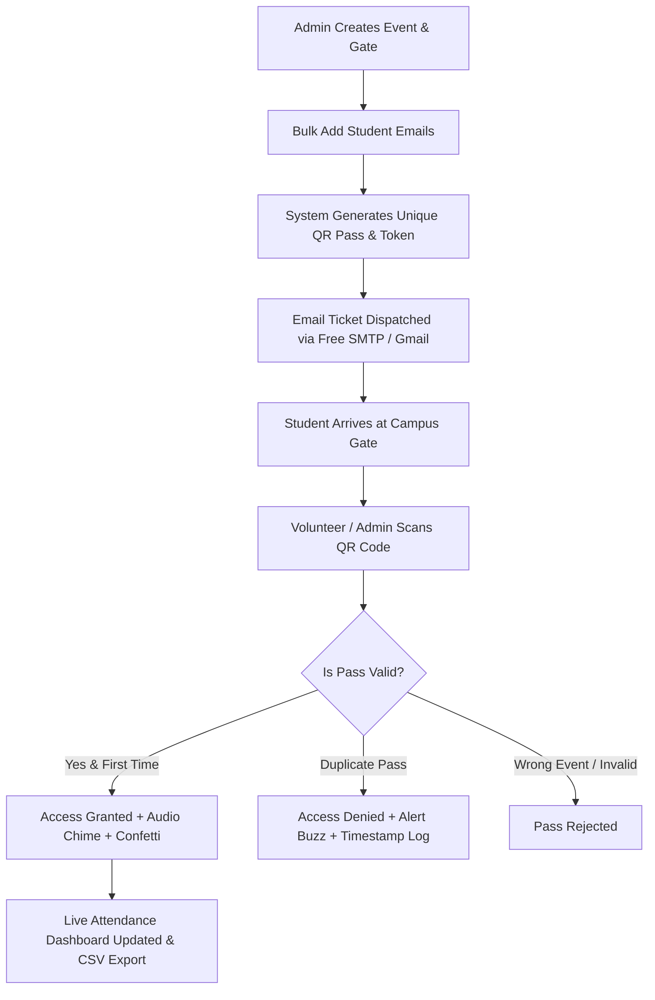

# 🎫 e-Pass.QR – Automated College Event & Gate Pass Management

> A modern, secure, and fast event access platform engineered for collegiate hackathons, symposiums, and festivals. Features live camera QR gate scanning, real-time duplicate pass prevention, scan-only volunteer authorization by email, and multi-provider Free SMTP ticket dispatch.

---

## 🌟 Key Features

### 📷 1. High-Performance Live QR Gate Scanner
- **Instant Camera Feed**: Automatically requests camera permissions and launches live viewfinder with scan guides.
- **Audio & Visual Feedback**: Web Audio synthesized success chimes, duplicate alert buzzers, and celebratory confetti upon admission.
- **Duplicate-Scan Prevention**: Instant detection of already-used passes with precise timestamps and previous scanner details.
- **Offline / Test Simulator**: One-click test pass simulator to test valid passes, used tickets, or invalid events even without physical cameras.
- **Image Upload & Manual Token Fallback**: Supports scanning screenshot passes and typing tokens manually.

### 👥 2. Scan-Only Volunteer Authorization by Email
- **Admin Delegation**: Super Admin can grant gate verification privileges to student volunteers by simply typing their email address.
- **Role-Based Security**: Volunteers are restricted to **Scan-Only Mode**—they cannot create events, delete attendee records, or clear data.
- **Immediate Credential Delivery**: Automatically dispatches scanner instructions and gate assignments to the volunteer's email via SMTP.
- **Quick Switch**: One-click role toggle for admins to test the volunteer perspective and return seamlessly.

### ✉️ 3. Free SMTP & Multi-Channel Pass Dispatch
- **Zero-Config Free SMTP**: Powered by built-in Ethereal SMTP relay. Every generated ticket email outputs a live web inbox URL viewable in the browser.
- **Real Gmail SMTP Support**: Connect your Admin Gmail account using a 16-character Google App Password to send directly from your personal or institutional email.
- **Free Cloud Providers**: Ready-to-use support for Brevo (300 free emails/day), Resend (3,000 free/month), and Mailtrap.
- **1-Click Gmail Web**: Instant web-compose link that opens `mail.google.com` with formatted ticket credentials and instructions.

### 🎫 4. Dynamic E-Tickets & Passes
- **Unique Digital Pass Tokens**: Cryptographic token generated per student containing verified metadata (`EPQR-...`).
- **Interactive Pass Viewer**: View and download QR passes, check in times, attendee department, and roll number.
- **Bulk Email Pass Generator**: Paste student emails to automatically register attendees, generate QR tickets, and queue email dispatchers.

### 📊 5. Attendance Analytics & Live Registry
- **Real-Time Attendance Hub**: Live headcounts, check-in percentages, and department-wise attendee breakdown.
- **Search & Filters**: Instant filter by check-in status (Checked In vs Registered) or search by roll number/name.
- **One-Click Export**: Export comprehensive CSV attendance logs compatible with Microsoft Excel and Google Sheets.

---

## 🛠️ Technology Stack

- **Frontend**: React 19, TypeScript, Tailwind CSS, Lucide React Icons, Canvas Confetti
- **QR Engine**: jsQR (browser-based zero-latency scanning), qrcode
- **Audio Feedback**: Web Audio API (cross-platform sound synthesis)
- **Backend & Dev Server**: Vite 6, Node.js, Express middleware
- **Email Service**: Nodemailer (Ethereal test relay, Gmail SMTP, Brevo, Resend)

---

## 🚀 Getting Started

### Prerequisites
- **Node.js**: v18.0 or higher
- **npm** or **bun**

### Installation

1. **Clone the repository:**
   ```bash
   git clone https://github.com/swadesh-hub/E-pass-.git
   cd E-pass-
   ```

2. **Install dependencies:**
   ```bash
   npm install
   ```

3. **Start the development server:**
   ```bash
   npm run dev
   ```

4. **Open in browser:**
   Navigate to [http://localhost:3000](http://localhost:3000)

---

## ⚙️ Configuration & Environment (Optional)

Create a `.env` file in the root directory to configure custom SMTP delivery (by default, the app uses Ethereal Free Test SMTP with zero configuration needed):

```env
# Optional: Real Admin Gmail SMTP Delivery
SMTP_HOST="smtp.gmail.com"
SMTP_PORT=587
SMTP_SECURE=false
SMTP_USER="your-admin-email@gmail.com"
SMTP_PASS="your-16-character-google-app-password"
SMTP_FROM='"Campus Gate Admin" <your-admin-email@gmail.com>'

# Optional: Brevo Free SMTP (300 emails/day)
# SMTP_HOST="smtp-relay.brevo.com"
# SMTP_PORT=587
# SMTP_USER="your-brevo-login"
# SMTP_PASS="your-brevo-smtp-key"
```

---

## 📖 How It Works



---

## 🛡️ Roles & Permissions

| Role | Permissions |
|---|---|
| **Super Admin** | Full access: Create events, authorize volunteers, manage attendance, reset data, and export CSV reports. |
| **Volunteer (Scan-Only)** | Scan passes at assigned gate, verify tickets, view live pass feedback. Restricted from creating/deleting events or modifying data. |

---

## 📄 License

This project is licensed under the Apache-2.0 License.
